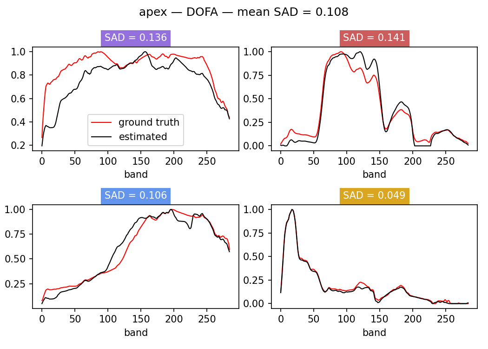
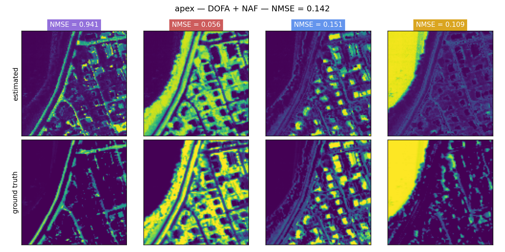

# Hyperspectral Foundation Model Feature Upsampling

Vision Transformers see an image through 16×16 patches: a 224×224 hyperspectral image
(HSI) fed to a foundation model comes out as a **14×14** grid of features, and most of the
spatial detail is gone. This project adapts **[NAF](https://github.com/valeoai/NAF)**, a
feature upsampler designed for natural-image foundation models (DINO, RADIO), to the
hyperspectral foundation model **[DOFA](https://github.com/zhu-xlab/DOFA)**, and
evaluates the upsampled features on **hyperspectral unmixing**.

> Course project (IM206). The upstream code of NAF, DOFA and SpectralEarth is
> credited in [Credits](#credits).

## Method

```
                    ┌──────────────────────────┐   128 ch, H×W
             ┌────▶ │ SpectralEarth adapter     │ ─────────────┐   guidance (queries / keys)
             │      │ (frozen, any #bands→128)  │              ▼
 HSI         │      └──────────────────────────┘      ┌──────────────────────┐
 B bands ────┤                                        │  NAF                  │──▶ features
 H×W         │      ┌──────────────────────────┐      │  image encoder + RoPE │    1024 ch, H×W
             └────▶ │ DOFA ViT-L/16 (frozen)    │ ───▶ │  cross-scale          │
                    │ wavelength-conditioned    │ 1024 │  neighborhood attn.   │
                    └──────────────────────────┘ ch,  └──────────────────────┘
                                                  14×14 (values)
```

* **DOFA** handles any number of spectral bands thanks to a patch embedding whose
  weights are generated from the band wavelengths. It is kept frozen and produces the
  low-resolution features (the attention *values*).
* **NAF** encodes the image with a small CNN (pixel + context branches) and RoPE, and
  every high-resolution query attends to a small neighborhood of low-resolution keys.
  Its image encoder expects a fixed number of channels, so the HSI first goes through
  the frozen **spectral adapter of SpectralEarth** (3D convolutions along the spectrum,
  any number of bands → 128 channels). NAF was modified to accept these 128 channels.
* **Training** – only NAF is trained (MSE between predicted and target DOFA features),
  on 600 EnMAP tiles (128×128, 202 bands) from SpectralEarth, with two strategies:
  * `7to14` (self-supervised): the 14×14 DOFA features are bilinearly downsampled to
    7×7, and NAF learns to recover the 14×14 features.
  * `14to28`: the target is a 28×28 mosaic of the DOFA features of the 4 image
    quadrants, the input the features of the full image.
* **Evaluation – unmixing.** Each pixel is modeled as a non-negative, sum-to-one
  mixture of `c` endmember spectra. A small network maps the features to abundance
  maps and a non-negative linear decoder (initialized with SiVM) reconstructs the image;
  it is trained without labels on the reconstruction loss. We compare raw DOFA features
  (14×14) to NAF-upsampled features (native resolution), with the `7to14` checkpoint.

## Results

APEX (285 bands, 110×110, 4 endmembers) and Jasper Ridge (198 bands, 100×100,
4 endmembers), seeds 0 / 1 / 2 of `scripts/unmix.py`; lower is better.
SAD: spectral angle between estimated and true endmembers (radians, averaged over
endmembers). NMSE: normalized squared error of the abundance maps.

| Scene | Features | SAD ↓ | NMSE ↓ |
|---|---|---|---|
| APEX | DOFA (14×14) | 0.108 / 0.110 / 0.319* | 0.151 / 0.151 / 0.751* |
| APEX | DOFA + NAF | **0.103 / 0.104 / 0.103** | **0.142 / 0.139 / 0.148** |
| Jasper | DOFA (14×14) | 0.144 / 0.145 / 0.146 | 0.226 / 0.237 / 0.232 |
| Jasper | DOFA + NAF | **0.141 / 0.140 / 0.140** | 0.233 / 0.235 / 0.231 |

\* the unmixing network did not converge for this seed.

On APEX, NAF features give better endmembers and abundances and a more stable
optimization; on Jasper Ridge they slightly improve the endmembers, while the
abundance error is unchanged.

| | DOFA features | DOFA + NAF features |
|:-:|:-:|:-:|
| Endmembers |  |  |
| Abundances |  |  |

## Installation

Python ≥ 3.10. A CUDA GPU is strongly recommended (DOFA ViT-L has 300M parameters).

```bash
git clone https://github.com/MangKaGO/hsi-naf-upsampling.git
cd hsi-naf-upsampling
python -m venv .venv && source .venv/bin/activate   # Windows: .venv\Scripts\activate
```

1. **PyTorch** – install the build matching your CUDA version from
   [pytorch.org](https://pytorch.org/get-started/locally/), e.g.
   ```bash
   pip install torch torchvision --index-url https://download.pytorch.org/whl/cu124
   ```
2. **Other dependencies**
   ```bash
   pip install -r requirements.txt
   ```
3. **NATTEN (optional, Linux + CUDA)** – fast neighborhood attention kernels used by NAF.
   The wheel must match your torch/CUDA versions, see the
   [NATTEN install guide](https://natten.org). Without NATTEN (e.g. on Windows/macOS/CPU),
   the code automatically falls back to a pure-PyTorch implementation
   (`hsnaf/third_party/naf/layers/na2d_torch.py`), which uses the same neighborhood
   definition (including dilation and border handling) but is slower.

### Pretrained weights (not included, put them in `weights/`)

| File | Source |
|---|---|
| `DOFA_ViT_large_e100.pth` (1.3 GB) | [Hugging Face `XShadow/DOFA`](https://huggingface.co/XShadow/DOFA) |
| `spec_ViTb_mae.pth` (only the spectral adapter is used) | [SpectralEarth pretrained models](https://syncandshare.desy.de/index.php/s/Po5bTPipz6EEHx3) |

```bash
huggingface-cli download XShadow/DOFA DOFA_ViT_large_e100.pth --local-dir weights
```

The trained NAF weights are included in `checkpoints/` (`naf_7to14.pth`, `naf_14to28.pth`, 3 MB each).

### Data (not included)

* **Unmixing scenes** – `data/unmixing/<scene>.mat` with matrices `Y` (bands × pixels),
  `A` (endmembers × pixels) and `E` (bands × endmembers). The wavelength files are
  included. Jasper Ridge, Samson, Urban and APEX are standard, publicly available
  unmixing benchmarks.
* **EnMAP tiles** (training only) – the EnMAP part of
  [SpectralEarth](https://geoservice.dlr.de/web/datasets/enmap_spectralearth)
  (free account required), as `.tif` files in `data/enmap/`.

## Usage

```bash
# Unmixing with NAF-upsampled features (default checkpoint: checkpoints/naf_7to14.pth)
python scripts/unmix.py --scene apex --features naf

# Baseline: raw DOFA features
python scripts/unmix.py --scene apex --features dofa

# Train NAF
python scripts/train_naf.py --mode 7to14
python scripts/train_naf.py --mode 14to28
```

Metrics and figures are written to `results/<scene>_<features>/`. Run any script with
`--help` for all options (weights paths, epochs, kernel size, seed...).

## Repository structure

```
hsnaf/
  backbones.py      DOFA encoder and SpectralEarth spectral adapter (frozen)
  upsampling.py     NAF construction, feature upsampling, training pairs (7to14 / 14to28)
  unmixing.py       unmixing network, loss, SiVM initialization, training loop
  metrics.py        SAD / NMSE with endmember matching (Hungarian algorithm)
  data.py           unmixing scenes and EnMAP tiles
  plots.py          figures
  third_party/      minimal code from NAF, DOFA and SpectralEarth (with licenses)
scripts/
  train_naf.py      train NAF on EnMAP
  unmix.py          unmixing evaluation
checkpoints/        trained NAF weights
data/               wavelength tables (datasets go here)
```

## Limitations

* Wavelengths are passed to DOFA in **nanometers**, while DOFA was pretrained with
  wavelengths in **micrometers**. The wavelength embedding is therefore outside its
  pretraining range; both the NAF checkpoints and the results above use nanometers.
* NAF is trained on DOFA features of 128×128 EnMAP tiles upsampled to 224×224, while
  unmixing scenes are 100–110 pixels wide: the scale of the training targets differs
  from the scale at which NAF is used.
* The unmixing network still contains a learned linear spatial upsampling layer; with
  NAF features (already at full resolution) it acts as a learned spatial mixing.

## Credits

This project reuses, in `hsnaf/third_party/`, a minimal subset of:

* **NAF** – Chambon et al., *NAF: Zero-Shot Feature Upsampling via Neighborhood Attention
  Filtering*, 2025. [code](https://github.com/valeoai/NAF) (Apache-2.0) · [paper](https://arxiv.org/abs/2511.18452).
  Modified to accept a configurable number of input channels.
* **DOFA** – Xiong et al., *Neural Plasticity-Inspired Multimodal Foundation Model for
  Earth Observation*, 2024. [code](https://github.com/zhu-xlab/DOFA) (MIT) · [paper](https://arxiv.org/abs/2403.15356).
* **SpectralEarth** – Braham et al., *SpectralEarth: Training Hyperspectral Foundation
  Models at Scale*, 2024. [code](https://github.com/AABNassim/spectral_earth) · [paper](https://arxiv.org/abs/2408.08447).
* The SiVM endmember extraction follows [UnDIP](https://github.com/BehnoodRasti/UnDIP).
