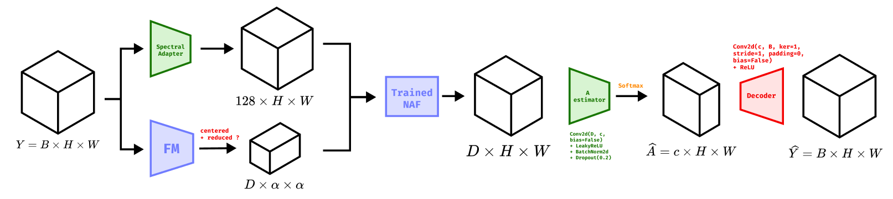
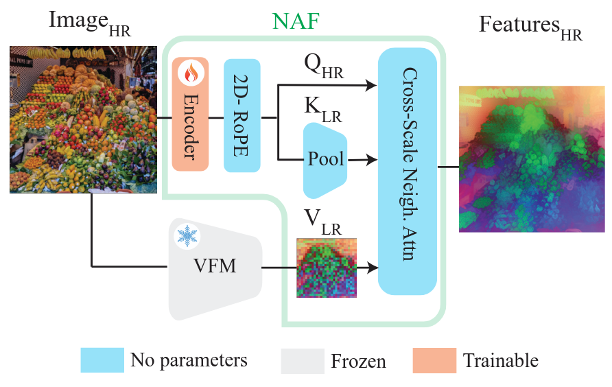
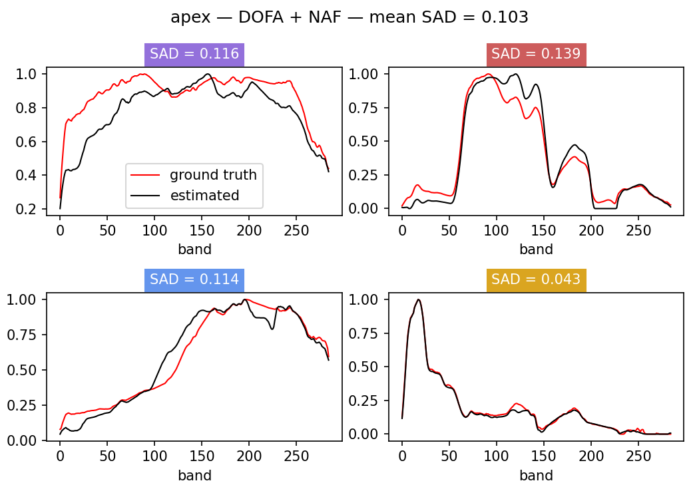
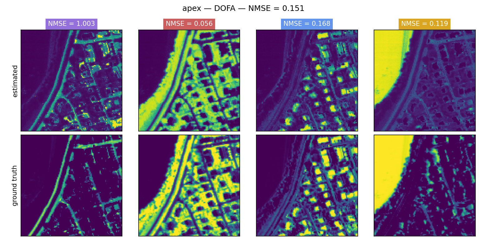

# Hyperspectral Foundation Model Feature Upsampling

**Training NAF on frozen DOFA features for unsupervised hyperspectral unmixing**

Lukas Tabouri · Obeye Essadani · Hussein El Gouch · Samy Bali
— Télécom Paris, IMA206 project (June 2026) · [📄 Report (PDF)](docs/report.pdf)



Hyperspectral foundation models such as **[DOFA](https://github.com/zhu-xlab/DOFA)**
produce semantically rich but spatially coarse features: as a Vision Transformer with
16×16 patches, DOFA turns a 224×224 hyperspectral image (HSI) into a **14×14** feature map.
This is a fundamental obstacle for pixel-level tasks such as **spectral unmixing**, whose
outputs live at the native image resolution.

This project adapts **[NAF](https://github.com/valeoai/NAF)** (Neighborhood Attention
Filtering), a feature upsampler designed for natural-image foundation models (DINO, RADIO),
to the hyperspectral setting:

* DOFA and the **[SpectralEarth](https://github.com/AABNassim/spectral_earth)** spectral
  adapter are kept **frozen**; **only NAF is trained**;
* training is **label-free** (feature self-distillation), so the whole pipeline stays
  compatible with *unsupervised* unmixing;
* the upsampled features are evaluated on **hyperspectral unmixing** (APEX, Jasper Ridge).

## Contents

- [Background](#background)
- [Method](#method)
- [Results](#results)
- [Installation](#installation)
- [Usage](#usage)
- [Repository structure](#repository-structure)
- [Limitations and perspectives](#limitations-and-perspectives)
- [Differences with the report](#differences-with-the-report)
- [Credits](#credits)

## Background

**Spectral unmixing.** An HSI records at every pixel a near-continuous reflectance
spectrum over hundreds of narrow bands, but with a coarse spatial resolution: a pixel
usually covers several materials. Under the *linear mixing model*, the image
$Y \in \mathbb{R}^{B \times P}$ ($B$ bands, $P$ pixels) is

$$Y = E\,A + N, \qquad E \in \mathbb{R}^{B \times c}_{+},\quad A \in \mathbb{R}^{c \times P}_{+},\quad \mathbf{1}^\top A = \mathbf{1}^\top,$$

where the columns of $E$ are the $c$ *endmember* spectra (pure materials) and $A$ holds
the per-pixel *abundances* (non-negative, summing to one). Unmixing recovers both $E$ and
$A$. It is a dense, per-pixel task, and spatial context helps disambiguate mixtures,
which is what spatially resolved deep features can provide.

**DOFA** is an Earth-observation foundation model whose patch-embedding weights are
generated by a hypernetwork from the bands' central wavelengths: a single ViT backbone
can ingest images with any number of spectral bands. Like any ViT, it outputs features
at a much lower resolution than its input.

**NAF** is a foundation-model-agnostic, image-guided upsampler. It reconstructs each
high-resolution feature as a learned, content- and position-aware combination of the
low-resolution features in a small neighborhood.

## Method

| NAF architecture (figure from the [NAF paper](https://arxiv.org/abs/2511.18452)) |
|:-:|
|  |

Given an HSI $Y \in \mathbb{R}^{B \times H \times W}$:

1. **Frozen feature extraction.** DOFA-Large (ViT-L/16) maps $Y$ (resized to 224×224) to
   $F \in \mathbb{R}^{1024 \times 14 \times 14}$: the attention **values** $V_{LR}$.
2. **Spectral adaptation + guidance encoding.** NAF's guidance encoder is a dual-branch CNN
   (a *pixel* branch with 1×1 convolutions and a *context* branch with 3×3 convolutions,
   concatenated) that expects a **fixed number of channels**, whereas $B$ varies across
   sensors. The frozen SpectralEarth spectral adapter (3D convolutions along the spectrum,
   from the `spec_ViTb_mae` checkpoint) first maps the $B$ bands to **128 channels**; NAF
   was modified to accept these 128 channels instead of RGB.
3. **Queries and keys.** 2D-RoPE is applied to the encoded guidance to get the
   high-resolution queries $Q_{HR}$; average pooling to the low resolution gives the keys $K_{LR}$.
4. **Cross-scale neighborhood attention.** Each high-resolution location $p$ attends only
   to a $k \times k$ neighborhood $\mathcal{N}(p)$ of its low-resolution counterpart:

$$F_{up}(p) = \sum_{q \in \mathcal{N}(p)} \alpha_{pq}\, V_{LR}(q), \qquad \alpha_{pq} = \mathrm{softmax}_{q \in \mathcal{N}(p)}\left(\frac{Q_{HR}(p)^\top K_{LR}(q)}{\sqrt{d}}\right).$$

This is a learned, adaptive interpolation kernel. The values are the frozen DOFA features,
so NAF never has to model DOFA's feature distribution: it only learns *where to look*.

### Training: feature self-distillation

No high-resolution "ground-truth" feature exists beyond DOFA's own 14×14 output, so the
upsampling task is simulated by first downsampling (`7to14` mode, used for all results):

$$\mathcal{L}(\theta) = \big\| \mathrm{NAF}_\theta\big({\downarrow} F,\; Y\big) - F \big\|_2^2, \qquad F = \mathrm{DOFA}(Y) \in \mathbb{R}^{1024\times 14\times 14},\quad {\downarrow}F \in \mathbb{R}^{1024\times 7\times 7}.$$

DOFA's native output is the teacher, and NAF must recover it from a 7×7 bilinear
sub-sampled copy, guided by the image. The target is a constant: only the NAF parameters
$\theta$ are updated. Because NAF is image-guided and resolution-agnostic, the learned
operator is then applied at inference to DOFA's native 14×14 features to reach the full
image resolution.

An alternative `14to28` mode is also implemented: the target is a 28×28 mosaic of the
DOFA features of the 4 image quadrants, and the input the features of the whole image.

*Training data:* 600 EnMAP tiles from SpectralEarth (128×128 pixels, 202 bands, each tile
scaled to max 1), 20 epochs, AdamW (lr 5·10⁻⁵), batch size 1.

### Evaluation: unmixing as a proxy task

The EnMAP training tiles have no ground truth, and there is no reference for
high-resolution features, so the quality of the upsampling is measured **indirectly**, on
a downstream task that has a ground truth and needs spatial detail: unmixing of benchmark
scenes with known endmembers and abundances (as NAF evaluates on segmentation / depth
probing for RGB images).

The unmixing head is a small auto-encoder trained **without labels** on each scene: the
features go through a learned spatial upsampling layer, a 1×1 convolution + LeakyReLU +
BatchNorm + Dropout, and a softmax (sum-to-one) to give the abundances $\hat A$; a
non-negative linear decoder, whose weights are the endmembers $\hat E$ (initialized with
SiVM), reconstructs $\hat Y$. The loss combines the spectral angle and normalized MSE
between $Y$ and $\hat Y$, a sparsity term on $\hat A$ and a regularization on $\hat E$.

Metrics, after matching estimated and reference endmembers (Hungarian algorithm):
* **SAD** – spectral angle between estimated and reference endmembers (radians, mean over endmembers);
* **NMSE** – normalized squared error of the abundance maps.

## Results

APEX (285 bands, 110×110, 4 endmembers) and Jasper Ridge (198 bands, 100×100,
4 endmembers), seeds 0 / 1 / 2 of `scripts/unmix.py`; lower is better. The two settings
share the same frozen DOFA-Large features and unmixing head: **DOFA** uses the raw
14×14 features, **DOFA + NAF** the features upsampled by NAF to the native resolution.

| Scene | Features | SAD ↓ | NMSE ↓ |
|---|---|---|---|
| APEX | DOFA (14×14) | 0.108 / 0.110 / 0.319* | 0.151 / 0.151 / 0.751* |
| APEX | DOFA + NAF | **0.103 / 0.104 / 0.103** | **0.142 / 0.139 / 0.148** |
| Jasper | DOFA (14×14) | 0.144 / 0.145 / 0.146 | 0.226 / 0.237 / 0.232 |
| Jasper | DOFA + NAF | **0.141 / 0.140 / 0.140** | 0.233 / 0.235 / 0.231 |

\* the unmixing network did not converge for this seed.

Per-endmember breakdown on APEX (seed 0):

| Metric | Features | EM1 | EM2 | EM3 | EM4 |
|---|---|---|---|---|---|
| SAD ↓ | DOFA | 0.136 | 0.141 | **0.106** | 0.049 |
| SAD ↓ | DOFA + NAF | **0.116** | **0.139** | 0.114 | **0.043** |
| NMSE ↓ | DOFA | 1.003 | 0.056 | 0.168 | 0.119 |
| NMSE ↓ | DOFA + NAF | **0.941** | 0.056 | **0.151** | **0.109** |

| | DOFA features | DOFA + NAF features |
|:-:|:-:|:-:|
| Endmembers |  |  |
| Abundances |  |  |

### Discussion

* **NAF helps, more on APEX than on Jasper.** On APEX, NAF features improve both the
  endmembers and the abundances, and make the optimization more stable (the baseline
  diverged for one seed out of three). On Jasper Ridge, the endmembers improve slightly
  while the abundance error is unchanged.
* **Endmembers.** EM4 is recovered almost exactly (SAD ≈ 0.04): its single sharp peak at
  short wavelengths is characteristic of water, consistent with its river-shaped abundance
  map. EM1 benefits the most from NAF (0.136 → 0.116).
* **Abundances: one endmember dominates the error.** EM1 has an NMSE close to 1 with both
  feature types: its reference map is made of thin, sparse linear structures (roads) that
  the unmixing head fails to localize. Since its spectrum is recovered reasonably well and
  improves with NAF, the bottleneck here is the unmixing head rather than the feature
  resolution.
* **ℓ2 metrics and edges.** A global ℓ2 abundance metric rewards matching the energy of
  the maps much more than the sharpness of boundaries, so improvements in spatial detail
  translate only partially into NMSE.

## Installation

Python ≥ 3.10. A CUDA GPU is strongly recommended (DOFA ViT-L has 300M parameters).

```bash
git clone https://github.com/MangKaGO/hsi-naf-upsampling.git
cd hsi-naf-upsampling
python -m venv .venv && source .venv/bin/activate   # Windows: .venv\Scripts\activate
```

1. **PyTorch** – install the build matching your CUDA version from
   [pytorch.org](https://pytorch.org/get-started/locally/), e.g.
   ```bash
   pip install torch torchvision --index-url https://download.pytorch.org/whl/cu124
   ```
2. **Other dependencies**
   ```bash
   pip install -r requirements.txt
   ```
3. **NATTEN (optional, Linux + CUDA)** – fast neighborhood attention kernels used by NAF.
   The wheel must match your torch/CUDA versions, see the
   [NATTEN install guide](https://natten.org). Without NATTEN (e.g. on Windows/macOS/CPU),
   the code automatically falls back to a pure-PyTorch implementation
   (`hsnaf/third_party/naf/layers/na2d_torch.py`), which uses the same neighborhood
   definition (including dilation and border handling) but is slower.

### Pretrained weights (not included, put them in `weights/`)

| File | Source |
|---|---|
| `DOFA_ViT_large_e100.pth` (1.3 GB) | [Hugging Face `XShadow/DOFA`](https://huggingface.co/XShadow/DOFA) |
| `spec_ViTb_mae.pth` (only the spectral adapter is used) | [SpectralEarth pretrained models](https://syncandshare.desy.de/index.php/s/Po5bTPipz6EEHx3) |

```bash
huggingface-cli download XShadow/DOFA DOFA_ViT_large_e100.pth --local-dir weights
```

The trained NAF weights are included in `checkpoints/` (`naf_7to14.pth`, `naf_14to28.pth`, 3 MB each).

### Data (not included)

* **Unmixing scenes** – `data/unmixing/<scene>.mat` with matrices `Y` (bands × pixels),
  `A` (endmembers × pixels) and `E` (bands × endmembers). The wavelength files are
  included. Jasper Ridge, Samson, Urban and APEX are standard, publicly available
  unmixing benchmarks.
* **EnMAP tiles** (training only) – the EnMAP part of
  [SpectralEarth](https://geoservice.dlr.de/web/datasets/enmap_spectralearth)
  (free account required), as `.tif` files in `data/enmap/`.

## Usage

```bash
# Unmixing with NAF-upsampled features (default checkpoint: checkpoints/naf_7to14.pth)
python scripts/unmix.py --scene apex --features naf

# Baseline: raw DOFA features
python scripts/unmix.py --scene apex --features dofa

# Train NAF
python scripts/train_naf.py --mode 7to14
python scripts/train_naf.py --mode 14to28
```

Metrics and figures are written to `results/<scene>_<features>/`. Run any script with
`--help` for all options (weights paths, epochs, kernel size, seed...).

## Repository structure

```
hsnaf/
  backbones.py      DOFA encoder and SpectralEarth spectral adapter (frozen)
  upsampling.py     NAF construction, feature upsampling, training pairs (7to14 / 14to28)
  unmixing.py       unmixing network, loss, SiVM initialization, training loop
  metrics.py        SAD / NMSE with endmember matching (Hungarian algorithm)
  data.py           unmixing scenes and EnMAP tiles
  plots.py          figures
  third_party/      minimal code from NAF, DOFA and SpectralEarth (with licenses)
scripts/
  train_naf.py      train NAF on EnMAP
  unmix.py          unmixing evaluation
checkpoints/        trained NAF weights
data/               wavelength tables (datasets go here)
docs/report.pdf     project report
assets/             figures
```

## Limitations and perspectives

* **Wavelength units.** Wavelengths are passed to DOFA in nanometers, while DOFA was
  pretrained with wavelengths in micrometers: the wavelength embedding is outside its
  pretraining range. The NAF checkpoints and the results above use nanometers.
* **Scale mismatch.** NAF is trained on DOFA features of 128×128 EnMAP tiles upsampled
  to 224×224, at a ×2 factor (7→14), but used at inference on 100–110-pixel scenes at a
  ×7–8 factor.
* **Unmixing head.** It contains a learned spatial upsampling layer which can partly
  compensate for the features' resolution, so the evaluation measures the features *and*
  the head. A simpler head (a 1×1 convolution, as in linear probing) would isolate the
  upsampler better. A spatially regularized or sparsity-aware head is also the natural
  next step to localize sparse endmembers such as EM1.
* **Other perspectives.** Evaluating the feature reconstruction error on held-out EnMAP
  tiles, and studying robustness to the number of input bands across sensors.

## Differences with the report

The code was cleaned and re-run after the report was written ([docs/report.pdf](docs/report.pdf)).
The numbers in this README differ from the report's Tables 1–2:

* **Mean SAD.** The report's mean SAD (0.099 → 0.072) was computed with a bug (the
  vectors were normalized along the wrong axis). The mean of the per-endmember values of
  the report's Table 2 is 0.113 → 0.095; the re-run values are given above.
* **Baseline.** The report calls the baseline "bilinear"; in the code, the baseline feeds
  the raw 14×14 DOFA features to the unmixing head, whose learned linear layer performs
  the upsampling. It is evaluated on the image resized to 224×224, NAF at native resolution.
* **Abundance figures.** The abundance maps were displayed after a global normalization,
  which explains the 0.005–0.010 color-bar ranges of the report's figures; the figures
  here show raw abundances in [0, 1].
* **Evaluation scene.** The scene referred to as "an urban hyperspectral scene" is APEX.

## Credits

This project reuses, in `hsnaf/third_party/`, a minimal subset of:

* **NAF** – Chambon et al., *NAF: Zero-Shot Feature Upsampling via Neighborhood Attention
  Filtering*, 2025. [code](https://github.com/valeoai/NAF) (Apache-2.0) · [paper](https://arxiv.org/abs/2511.18452).
  Modified to accept a configurable number of input channels. The architecture figure
  above is taken from this work.
* **DOFA** – Xiong et al., *Neural Plasticity-Inspired Multimodal Foundation Model for
  Earth Observation*, 2024. [code](https://github.com/zhu-xlab/DOFA) (MIT) · [paper](https://arxiv.org/abs/2403.15356).
* **SpectralEarth** – Braham et al., *SpectralEarth: Training Hyperspectral Foundation
  Models at Scale*, 2025. [code](https://github.com/AABNassim/spectral_earth) · [paper](https://arxiv.org/abs/2408.08447).
* **Neighborhood Attention** – Hassani et al., *Neighborhood Attention Transformer*, CVPR 2023.
* **RoPE** – Su et al., *RoFormer: Enhanced Transformer with Rotary Position Embedding*, 2024.
* The SiVM endmember extraction follows [UnDIP](https://github.com/BehnoodRasti/UnDIP).
